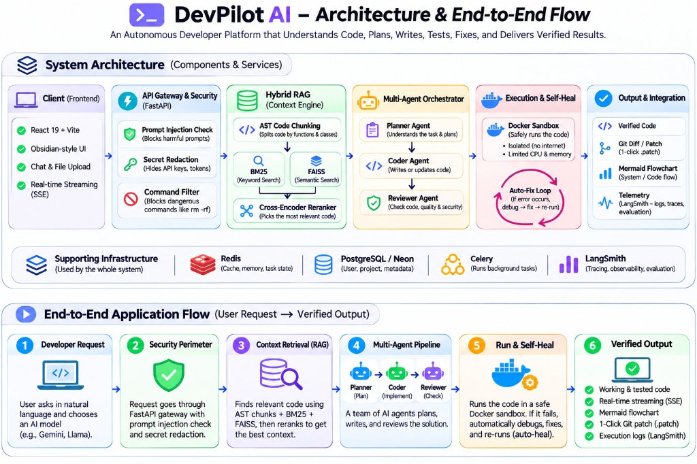

<div align="center">

# ⚡ DevPilot AI v2.0

**An Autonomous Developer Platform that Understands Code, Plans, Writes, Tests, Fixes, and Delivers Verified Results.**

---

[](https://fastapi.tiangolo.com)
[](https://python.org)
[](https://reactjs.org)
[](https://vitejs.dev)
[](https://docker.com)
[](LICENSE)

</div>

---

## 💡 What is DevPilot AI?

Most AI coding assistants only generate text. If there is a syntax error or a broken import, **you** have to test and fix it yourself.

**DevPilot AI works differently:**
1. It analyzes your repository using **AST-aware Hybrid Search** (finding exact functions and concepts).
2. A team of AI agents (**Planner, Coder, Reviewer**) plans and writes the solution.
3. It runs the code inside an **isolated Docker sandbox**.
4. **Self-Healing Loop**: If the code crashes or fails a test, the **Debugger Agent** automatically fixes the bug and re-runs it until it works.
5. You receive verified code with a 1-click **Git Patch (`.patch`)** ready to apply.

---

## 🏗️ Architecture & End-to-End Flow

<div align="center">



</div>

---

## ✨ Key Features (To The Point)

* 🔄 **Closed-Loop Self-Healing**: Automatically catches runtime errors, writes a fix, and verifies code in a sandbox (up to 2 auto-repair iterations).
* 🧠 **Hybrid Code RAG**: Combines keyword search (BM25) and semantic vector search (FAISS) without slicing functions or classes in half.
* ⚡ **1-Click Model Switcher**: Hot-swap between **DeepSeek R1**, **Llama 3.3 70B**, **Gemini 2.0 Flash**, and **Qwen 2.5 Coder** directly from the UI header.
* 🛡️ **Enterprise Security**:
  * Blocks destructive terminal commands (`rm -rf`, disk wipes, fork bombs).
  * Intercepts prompt injection and jailbreak attempts.
  * Masks sensitive API keys and secrets in real-time (`[REDACTED_SECRET]`).
  * Runs code in a zero-network container (`--network none`) with strict CPU/memory limits.
* 🎨 **Obsidian Dark UI & Touch Gestures**:
  * **2-finger pinch-to-zoom (35% to 400%)** and **1-finger pan** on architecture diagrams (works on mobile, tablets, and Mac trackpads).
  * **Rock-solid streaming**: Screen text stays static without jitter or shaking while AI streams.
  * **1-click Git Patch export**: Download `.patch` file or copy to clipboard to apply with `git apply`.
* 📊 **Built-in Telemetry**: Tracks response latency, cache hits, token usage, and LangSmith traces.

---

## 🚀 Quick Start

### Option 1: Docker (Recommended — 1 Command)

```bash
# 1. Clone the repo
git clone https://github.com/harshitgangwar/devpilot-ai.git
cd devpilot-ai

# 2. Add your OpenRouter API Key
cp .env.example .env
# Open .env and set OPENROUTER_API_KEY=your_key_here

# 3. Start everything
docker-compose up --build
```

* **Frontend UI**: [http://localhost:5173](http://localhost:5173)
* **Backend API**: [http://localhost:8000](http://localhost:8000)
* **API Documentation**: [http://localhost:8000/docs](http://localhost:8000/docs)

---

### Option 2: Manual Local Setup

#### Backend (Python)
```bash
# Setup virtual environment
python3 -m venv venv
source venv/bin/activate    # On Windows: venv\Scripts\activate

# Install dependencies & configure env
pip install -r requirements.txt
cp .env.example .env

# Run FastAPI server
uvicorn app.main:app --reload --port 8000
```

#### Frontend (React)
```bash
cd ui
npm install
npm run dev
```

Open [http://localhost:5173](http://localhost:5173) in your browser.

---

## ⚙️ Environment Configuration (`.env`)

Only `OPENROUTER_API_KEY` is required to start:

```env
# Required: LLM API Key (Supports free and paid models)
OPENROUTER_API_KEY=sk-or-v1-xxxxxxxxxxxxxxxx

# Optional: Cache & Task Queue (Defaults to local)
REDIS_URL=redis://localhost:6379/0

# Optional: Observability
LANGSMITH_TRACING=false
LANGSMITH_API_KEY=
LANGSMITH_PROJECT=devpilot-ai
```

---

## 🧪 Testing

Run all backend security, diff, and self-healing tests:

```bash
PYTHONPATH=. ./venv/bin/python -c "
import tests.test_api_endpoints as t
funcs = [getattr(t, f) for f in dir(t) if f.startswith('test_')]
for fn in funcs:
    fn()
print(f'All {len(funcs)} tests passed!')
"
```

Build the frontend to verify zero errors:
```bash
cd ui && npm run build
```

---

## 🔌 Main API Endpoints

| Method | Endpoint | What It Does |
| :--- | :--- | :--- |
| `POST` | `/ask/stream` | Streams answer with dynamic model and RAG context |
| `POST` | `/agent/run/stream` | Runs multi-agent team with self-healing feedback |
| `POST` | `/upload-repo` | Indexes a local folder using AST code chunking |
| `POST` | `/upload-github` | Clones and indexes a public GitHub repository |
| `POST` | `/diff/preview` | Generates a unified git diff for suggested code |
| `POST` | `/diff/apply` | Applies the validated diff directly to files |
| `GET` | `/api/observability/overview` | Live metrics, latency, and system health status |

---

## 📁 Project Structure

```
devpilot-ai/
├── app/
│   ├── agents/          # Multi-agent orchestrator, planner, coder, debugger, executor
│   ├── core/            # Guardrails (injection defense, secret redaction, rate limiter)
│   ├── rag/             # BM25, FAISS VectorStore, AST chunker, Cross-Encoder
│   ├── routes/          # FastAPI API routes (ask, stream, agent, diff, upload)
│   └── tasks/           # Celery execution tasks & sandboxed Docker runner
├── ui/
│   ├── src/components/  # React components (AskWorkspace, AgentWorkspace, MermaidBlock)
│   └── src/index.css    # Cyber Obsidian dark theme & touch gesture styles
├── assets/              # Architecture and flow diagram
├── docker-compose.yml   # Multi-container setup
└── requirements.txt     # Python dependencies
```

---

## 🧑‍💻 Author & License

* **Built By**: [Harshit Gangwar](https://github.com/harshitgangwar)
* **License**: [MIT License](LICENSE)
