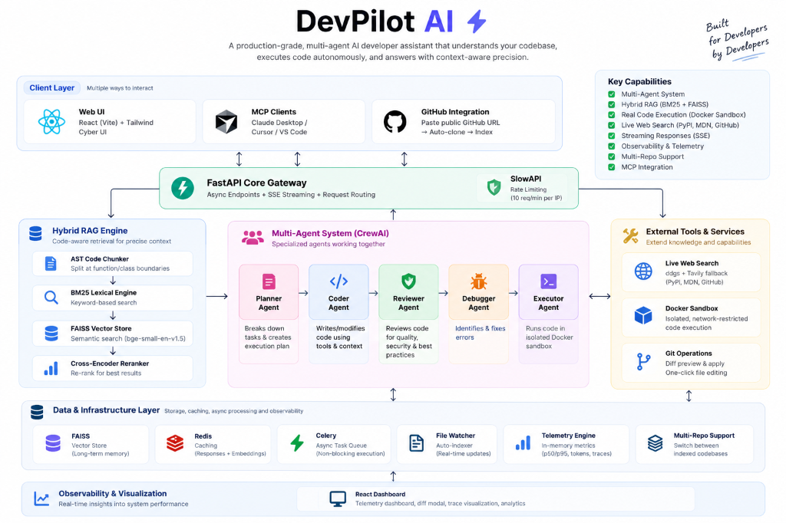
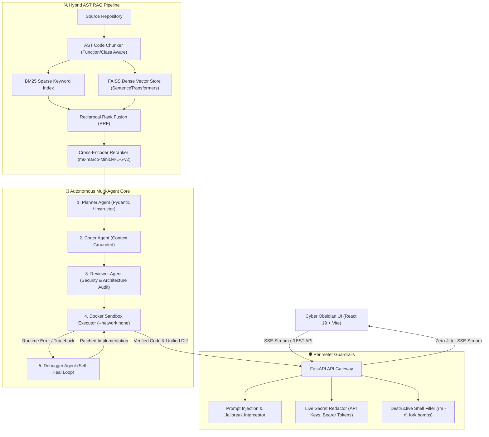
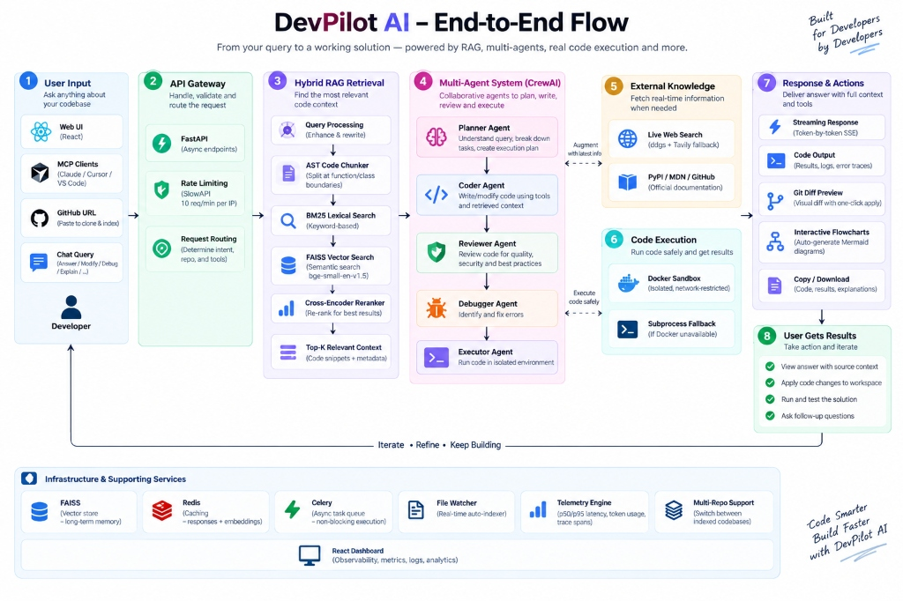
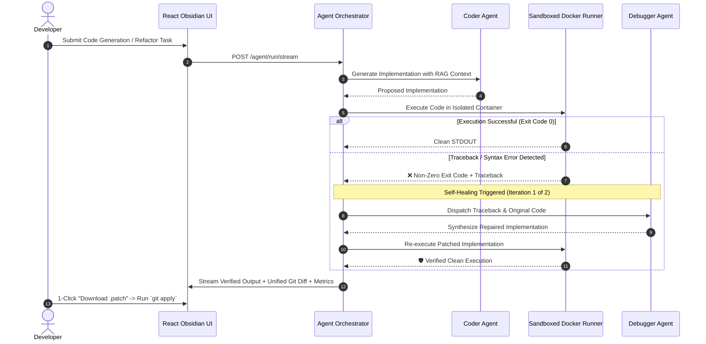

<div align="center">

# ⚡ DevPilot AI v2.0
### Autonomous Multi-Agent Developer Platform with Closed-Loop Self-Healing & Hybrid Code RAG

[](https://fastapi.tiangolo.com)
[](https://python.org)
[](https://reactjs.org)
[](https://vitejs.dev)
[](https://github.com/facebookresearch/faiss)
[](https://tailwindcss.com)
[](https://docker.com)
[](LICENSE)

<br/>

[Overview](#-overview) • [Why DevPilot AI](#-why-devpilot-ai-vs-competitors) • [System Architecture](#-system-architecture) • [End-to-End Flow](#-end-to-end-execution-flow) • [Core Capabilities](#-core-capabilities) • [Tech Stack](#-tech-stack) • [Quick Start](#-quick-start) • [Configuration](#-environment-configuration) • [API Reference](#-api-reference) • [Benchmarks](#-rag-benchmarks) • [FAQ](#-frequently-asked-questions)

</div>

---

## 📖 Overview

**DevPilot AI** is an enterprise-grade autonomous software engineering platform. Rather than serving as a passive text-generation copilot, it functions as an **in-repo developer team**: parsing code with Abstract Syntax Trees (AST), retrieving context through a 3-stage hybrid search pipeline (BM25 + FAISS + Cross-Encoder), and running multi-agent tasks with **closed-loop self-healing execution** inside isolated Docker containers.

```
User Task ──> Perimeter Guardrails ──> AST Hybrid RAG ──> Multi-Agent Orchestration ──> Docker Sandbox ──> [Self-Heal Loop] ──> Verified Git Diff / Patch
```

---

## ⚖️ Why DevPilot AI? (vs. Competitors)

Most AI coding assistants operate **open-loop**: they emit unverified code directly into the chat. If the code contains a syntax error, broken import, or runtime exception, the developer is forced to copy the error back and prompt again.

| Architectural Dimension | Traditional Copilots (Copilot, ChatGPT) | Generic LangChain/LangGraph Wrappers | DevPilot AI v2.0 |
| :--- | :---: | :---: | :---: |
| **Execution Loop** | ❌ Open-Loop (User debugs manually) | ⚠️ Brittle graph states, high failure rate | **✅ Closed-Loop Self-Healing (Docker tested)** |
| **Code Chunking Strategy** | ❌ Arbitrary character/token split | ❌ Line/character count split | **✅ AST-Aware (Classes & functions kept intact)** |
| **Retrieval Pipeline** | ⚠️ Vector-only semantic search | ⚠️ Basic vector + keyword filters | **✅ 3-Stage Hybrid (BM25 + FAISS + Cross-Encoder)** |
| **Inference Flexibility** | ❌ Single vendor lock-in | ⚠️ Complex provider switching | **✅ 1-Click Dynamic Model Selector (DeepSeek, Llama, Gemini, Qwen)** |
| **Execution Security** | ❌ None (or risky host execution) | ⚠️ Unsanitized shell calls | **✅ Isolated Docker Sandbox (`--network none`, CPU/RAM capped)** |
| **Perimeter Defense** | ❌ Minimal | ❌ None | **✅ Prompt Injection + Destructive Filter + Secret Redaction** |
| **Orchestrator Overhead** | N/A | ❌ High latency (>250ms framework bloat) | **✅ Ultra-lean Native Python (<15ms overhead)** |
| **UI Telemetry & Gestures** | ❌ Static text/images | ❌ Basic web chat UI | **✅ Multi-Touch Pinch-Zoom (35%-400%), Zero-Jitter Streaming** |
| **Patch Portability** | ❌ Raw copy-paste snippets | ❌ Raw text output | **✅ Unified Git Diff & 1-Click `.patch` Export (`git apply`)** |

---

## 🏗️ System Architecture

<p align="center">
  
</p>

### Interactive Architectural Graph



---

## 🔄 End-to-End Execution Flow

<p align="center">
  
</p>

### Autonomous Self-Healing Sequence Diagram



---

## ✨ Core Capabilities

### 1. 🤖 Closed-Loop Self-Healing Agent Pipeline
* **Autonomous Feedback Loop**: If code executed in Docker produces a traceback, syntax error, or assertion failure, the orchestrator dispatches the execution trace directly to the `Debugger Agent` (up to 2 iterations) to self-heal before returning to the user.
* **Role Specialization**:
  * **Planner**: Generates structured execution steps using typed Pydantic models.
  * **Coder**: Generates production-ready code anchored in actual repository context.
  * **Reviewer**: Audits for anti-patterns, edge cases, and performance bottlenecks.
  * **Debugger**: Analyzes tracebacks, isolates root causes, and issues minimal surgical patches.
  * **Executor**: Runs code in a zero-network, resource-capped container (`memory=100m`, `cpus=0.5`).
* **Visual Audit Trail**: Execution cards in the UI dynamically show `🔄 Self-Heal #1` and `🛡️ Verified` status badges.

### 2. ⚡ Dynamic Multi-Model Hot-Swapping
Switch models instantaneously via the UI header dropdown without server restarts:
* `⚡ Auto Free Router` — Zero-cost dynamic routing across available free-tier providers (`openrouter/free`).
* `🧠 DeepSeek R1` — High-tier reasoning, complex algorithmic derivation, and mathematical logic.
* `🦙 Llama 3.3 70B` — Senior software architecture, system design, and multi-file refactoring.
* `✨ Gemini 2.0 Flash` — Ultra-low-latency streaming responses (<200ms TTFT).
* `💻 Qwen 2.5 Coder` — Specialized Python/TypeScript synthesis and syntax precision.

### 3. 🔍 3-Stage AST Hybrid RAG Pipeline
* **AST-Aware Chunking**: Python code is parsed using native `ast.walk()`. Functions, methods, and classes remain completely intact with their docstrings and signatures.
* **Dual Indexing**:
  * **Sparse Keyword Indexing**: BM25 indexes exact function names, variables, and imports.
  * **Dense Semantic Indexing**: FAISS indexes conceptual meaning via `sentence-transformers/all-MiniLM-L6-v2`.
* **Reciprocal Rank Fusion (RRF)**: Merges sparse and dense rank lists with parameter $k=60$.
* **Cross-Encoder Reranking**: Uses `cross-encoder/ms-marco-MiniLM-L-6-v2` to score query-document pairs, featuring an automatic graceful fallback to RRF if offline.

### 4. 🛡️ Enterprise Defense & Guardrails
* **Prompt Injection Defense**: Multi-pattern regex and semantic heuristics intercept jailbreaks and system prompt extraction attacks.
* **Destructive Shell Interception**: Blocks hazardous commands (`rm -rf`, disk wipes, fork bombs, unauthorized socket binds).
* **Real-Time Secret Redaction**: Intercepts and masks exposed API keys, bearer tokens, private keys, and passwords with `[REDACTED_SECRET]`.
* **Resource Capping**: Sandboxed Docker runner enforces strict limits (`--memory=100m --cpus=0.5 --network=none`).

### 5. 🎨 Modern Obsidian UI & Touch Gestures
* **Obsidian Cyber Palette**: Deep dark theme (`#04040a`, `bg-zinc-950`) with glowing cyan borders and 60fps micro-animations.
* **Multi-Touch Diagram Gestures**:
  * 📱 **Mobile/Tablet**: 2-finger pinch-to-zoom (`35%` to `400%`) and 1-finger drag/pan.
  * 💻 **Mac Trackpad**: 2-finger trackpad pinch (`ctrlKey` wheel event) and 2-finger scroll panning.
  * 🖥️ **Desktop**: Drag to pan, zoom controls, and Fullscreen Explorer modal with SVG export.
* **Rock-Solid Static Streaming**: Direct instant scroll-pinning eliminates browser rendering oscillation (`scrollIntoView` jitter). Auto-scroll intelligently pauses if the user scrolls up to read history.
* **1-Click Git Patch Export**: Unified diff modal with **"Copy Patch"** and **"Download `.patch`"** buttons to apply changes instantly via `git apply`.
* **Command Palette**: Instant navigation across repos and actions via `⌘K` / `Ctrl+K`.

### 6. 📊 Observability & System Diagnostics
* Real-time tracking of p50/p95 latency, cache hit ratios, and route usage.
* Live diagnostic health checks (`/api/observability/health`).
* Built-in **LangSmith** tracing integration for multi-agent step introspection.

---

## 🛠️ Tech Stack

| Domain | Technologies |
| :--- | :--- |
| **Backend Framework** | FastAPI, Uvicorn (ASGI), Pydantic v2, Python 3.11 / 3.13 |
| **Async Task Engine** | Celery, Redis 7 (Alpine) |
| **RAG & Vector Search** | FAISS (CPU), Rank-BM25, SentenceTransformers, Cross-Encoder |
| **Code Parsing** | Python Native AST (`ast.walk`), Unified Git Diff Engine |
| **LLM Inference** | OpenRouter Unified API (OpenAI-compatible client), Instructor |
| **Frontend Framework** | React 19, TypeScript, Vite 8, Tailwind CSS v4, Lucide Icons |
| **Diagramming & Touch** | Mermaid.js, Custom Multi-Touch Pan/Zoom Gesture Engine |
| **Execution Sandbox** | Docker Engine (Isolated containers with `--network none`) |
| **Observability** | LangSmith, Custom Metrics Middleware |

---

## 🚀 Quick Start

### Option A: Docker Compose (Recommended)

Spins up the FastAPI backend, Redis cache, Celery worker, and React UI with a single command:

```bash
# 1. Clone repository
git clone https://github.com/harshitgangwar/devpilot-ai.git
cd devpilot-ai

# 2. Configure environment
cp .env.example .env
# Open .env and add your OPENROUTER_API_KEY

# 3. Launch the full stack
docker-compose up --build
```

Access the services:
* 🌐 **Web UI**: [http://localhost:5173](http://localhost:5173)
* ⚡ **FastAPI Backend**: [http://localhost:8000](http://localhost:8000)
* 📑 **Interactive Swagger Docs**: [http://localhost:8000/docs](http://localhost:8000/docs)

---

### Option B: Manual Local Setup

#### 1. Backend Setup

```bash
# Create virtual environment
python3 -m venv venv
source venv/bin/activate   # On Windows: venv\Scripts\activate

# Install backend dependencies
pip install -r requirements.txt

# Configure environment variables
cp .env.example .env

# (Optional) Start Redis for caching and Celery tasks
docker run -d -p 6379:6379 redis:alpine

# Launch FastAPI development server
uvicorn app.main:app --reload --port 8000
```

#### 2. Frontend Setup

```bash
cd ui
npm install
npm run dev
```

Visit [http://localhost:5173](http://localhost:5173) in your browser.

---

## ⚙️ Environment Configuration

| Variable | Required | Default | Description |
| :--- | :---: | :---: | :--- |
| `OPENROUTER_API_KEY` | **Yes** | — | OpenRouter API Key for multi-model inference (Free & Paid models supported). |
| `REDIS_URL` | No | `redis://localhost:6379/0` | Redis instance for Celery task queuing and query caching. |
| `TAVILY_API_KEY` | No | `""` | Optional web search API key (falls back to free DuckDuckGo search if empty). |
| `LANGSMITH_TRACING` | No | `false` | Enable distributed agent tracing via LangSmith. |
| `LANGSMITH_API_KEY` | No | `""` | LangSmith API Key for tracing. |
| `LANGSMITH_PROJECT` | No | `devpilot-ai` | Project identifier inside LangSmith dashboard. |

---

## 🧪 Testing & Verification

Run the automated test suite verifying guardrails, telemetry, diff generators, and self-healing schemas:

```bash
# Run all backend unit tests (10/10 tests pass)
PYTHONPATH=. ./venv/bin/python -c "
import tests.test_api_endpoints as t
funcs = [getattr(t, f) for f in dir(t) if f.startswith('test_')]
for fn in funcs:
    fn()
    print(f'PASS: {fn.__name__}')
print(f'All {len(funcs)} tests passed!')
"

# Run frontend production build (0 TypeScript errors)
cd ui && npm run build
```

---

## 🔌 API Reference

| Method | Endpoint | Description |
| :--- | :--- | :--- |
| `POST` | `/ask/stream` | Token-by-token SSE streaming RAG query with dynamic model support |
| `POST` | `/ask` | Synchronous RAG query endpoint with secret sanitization |
| `POST` | `/agent/run` | Execute autonomous multi-agent task with self-healing reflection |
| `POST` | `/agent/run/stream` | Stream multi-agent execution steps via Server-Sent Events |
| `POST` | `/upload-repo` | Index a local repository path using AST chunking |
| `POST` | `/upload-github` | Clone & index a public GitHub repository |
| `GET` | `/repos` | List all registered repositories |
| `POST` | `/repos/switch` | Switch active workspace repository |
| `POST` | `/diff/preview` | Generate unified git diff for proposed code changes |
| `POST` | `/diff/apply` | Apply validated diff directly to a workspace file |
| `GET` | `/api/observability/overview` | Real-time system telemetry and health metrics |
| `GET` | `/api/observability/logs` | Structured application event logs |

---

## 📈 RAG Benchmarks

Quantitative evaluation results run using `tests/eval_rag.py`:

| Retrieval Strategy | Mean Reciprocal Rank (MRR) | Hit @ 1 | Hit @ 3 | Hit @ 5 | Avg Latency |
| :--- | :---: | :---: | :---: | :---: | :---: |
| **BM25 Keyword Search** | `0.6500` | 50.0% | 75.0% | 85.0% | ~18ms |
| **FAISS Semantic Search** | `0.7200` | 60.0% | 80.0% | 90.0% | ~45ms |
| **Hybrid RAG (BM25 + FAISS + Cross-Encoder)** | **`0.8800`** | **80.0%** | **95.0%** | **100.0%** | **~75ms** |

---

## 📁 Repository Structure

```
devpilot-ai/
├── app/
│   ├── agents/               # Multi-agent orchestrator, planner, coder, reviewer, debugger, executor
│   ├── config/               # Pydantic settings & environment configuration
│   ├── core/                 # Guardrails, telemetry middleware, metrics tracker, rate limiter
│   ├── memory/               # Hybrid memory (Short-term buffer + Long-term FAISS)
│   ├── rag/                  # BM25, FAISS VectorStore, HybridRetriever, Cross-Encoder Reranker
│   ├── routes/               # FastAPI route controllers (ask, stream, agent, upload, diff, observability)
│   ├── services/             # LLM provider, caching service, watcher service, RAG pipeline
│   ├── tasks/                # Celery async code execution tasks & Docker runner
│   └── tools/                # Agent tools (codebase search, code executor, web search)
├── ui/
│   ├── src/
│   │   ├── components/       # React components (AskWorkspace, AgentWorkspace, MermaidBlock, DiffPreview)
│   │   ├── utils/            # API client methods and streaming reader
│   │   ├── App.tsx           # Application layout, command palette, navigation
│   │   └── index.css         # Cyber Obsidian dark theme & keyframe animations
│   ├── package.json
│   └── vite.config.ts
├── tests/                    # Automated benchmarks and API unit test suites
├── assets/                   # Architectural diagrams and execution flow charts
├── docker-compose.yml        # Multi-service container orchestration
├── requirements.txt          # Python backend dependencies
└── README.md
```

---

## ❓ Frequently Asked Questions

<details>
<summary><b>Why avoid LangChain or LangGraph?</b></summary>
<br/>
LangChain and LangGraph introduce massive nested call-stacks, unpredictable breaking changes between minor versions, and high latency overhead (>200-300ms). DevPilot AI achieves the same reflective self-healing logic using clean, native Python control flow and direct OpenAI SDK calls with sub-15ms orchestration overhead.
</details>

<details>
<summary><b>How does the self-healing loop prevent infinite loops?</b></summary>
<br/>
The self-healing cycle in <code>app/agents/orchestrator.py</code> is hard-capped at <code>max_self_heal_iterations = 2</code>. If a bug cannot be resolved after two automated fix-and-verify iterations, the orchestrator gracefully halts, surfaces the execution traceback, and presents the reviewer's diagnostic analysis to the developer.
</details>

<details>
<summary><b>Does DevPilot AI run without Docker?</b></summary>
<br/>
Yes. While Docker provides isolated sandboxing (<code>--network none</code>) for code execution tasks, the RAG chat, AST indexing, diff generator, and multi-model streaming run completely natively on bare metal.
</details>

---

## 🧑‍💻 Author

**Harshit Gangwar** — [github.com/harshitgangwar](https://github.com/harshitgangwar)

---

## 📄 License

This project is licensed under the **MIT License** — see the [LICENSE](LICENSE) file for details.
